# 🛍️ Awesome Headless Ecommerce 

  

  
  
  
  
  
  

---

## 🧭 Overview & Ecosystem Highlights

A curated directory and developer guide to **Headless Ecommerce**, **Composable Commerce**, **API-First Platforms**, and **Modern Decoupled Storefronts**. 

Headless ecommerce decouples frontend customer touchpoints (web, mobile apps, IoT, POS, smart kiosks) from backend transactional commerce engines (product catalogs, carts, promotions, payments, inventory, order management). By bridging systems via high-performance REST and GraphQL APIs, headless architectures enable engineering teams to achieve rapid UI iterations, lightning-fast Core Web Vitals, omnichannel reach, and complete design freedom without monolithic vendor lock-in.

---

## 📑 Table of Contents

- [📊 Sector Overview & Market Dynamics](#-sector-overview--market-dynamics)
- [☁️ SaaS & Hosted Platforms](#️-saas--hosted-platforms)
- [🐙 Open-Source GitHub Projects](#-open-source-github-projects)
- [🤝 How to Contribute](#-how-to-contribute)
- [💖 Support & Sponsorship](#-support--sponsorship)
- [📈 Star History](#-star-history)
- [⚠️ Disclaimer](#️-disclaimer)

---

## 📊 Sector Overview & Market Dynamics

The global headless commerce market is currently valued at approximately **$2.0B – $2.4B** and is expanding rapidly at an estimated **CAGR of 21% – 22.6%**, projected to reach **$6.2B – $7.2B** into the 2030s. The sector exhibits **moderate fragmentation across its modular layers** rather than a winner-take-all monopoly: while enterprise heavyweights dominate core backend and CRM ecosystems, brands actively distribute their stacks across best-of-breed API-first commerce backends, specialized headless CMS providers, and decoupled modern storefronts.

---

## ☁️ SaaS & Hosted Platforms

| Platform | Starting Price | Free Tier / Trial Limits | Company Size (Market Cap / Valuation / Revenue) | Description |
| :--- | :--- | :--- | :--- | :--- |
| **[Shopify Plus](https://www.shopify.com/plus)** | $2,300/month (3-year contract) or $2,500/month (1-year contract) | No public free trial; 30 to 60-day sales-assisted evaluation sandboxes provided for enterprise migrations | ~$220B Market Cap (NYSE: SHOP) | Enterprise tier with B2B features, multi-store management, and headless support via Hydrogen & Oxygen. |
| **[Salesforce Commerce Cloud](https://www.salesforce.com/products/commerce-cloud/)** | ~$12,500/month ($150,000/year minimum contract or ~1% GMV) | No self-serve trial; custom guided sandbox demos available through sales consultation | ~$200B Market Cap (NYSE: CRM) | Enterprise B2B/B2C commerce suite on the Salesforce platform featuring Agentforce AI, native OMS, and composable storefronts. |
| **[Adobe Commerce (Magento)](https://business.adobe.com/products/magento/magento-commerce.html)** | $1,833/month ($22,000/year for On-Premise; $40,000/year for Cloud) | No SaaS free trial (evaluation via Magento Open Source perpetual free download without time limits) | ~$98B Market Cap (NASDAQ: ADBE) | Enterprise version of Magento with advanced B2B features, AI-powered merchandising, and multi-database architecture. |
| **[commercetools](https://commercetools.com/)** | ~$3,333/month ($40,000/year minimum annual contract) | 60-day free trial (unlimited API calls, preloaded sample B2B/B2C datasets, Merchant Center access, no credit card required) | $1.9B Valuation / $100M+ ARR | Category pioneer of composable commerce with cloud-native, API-first architecture designed for enterprise flexibility. |
| **[VTEX](https://vtex.com/)** | $2,000/month base platform fee + revenue/GMV share | No self-serve free trial; access requires scheduled guided proof-of-concept (PoC) demo environments | ~$720M Market Cap (NYSE: VTEX) | AI-native enterprise commerce and marketplace suite with unified OMS, conversational commerce, and retail media engine. |
| **[Spryker](https://spryker.com/)** | ~$8,333/month ($100,000/year minimum annual contract) | No self-serve free trial; 45-day sales-coordinated evaluation sandboxes via cloud partner marketplaces | ~$500M Valuation / $152M raised | Composable, API-first B2B commerce and marketplace platform optimized for complex catalogs and multi-region operations. |
| **[BigCommerce Enterprise](https://www.bigcommerce.com/enterprise/)** | $1,000/month (Standard plans start at $39/month to $399/month) | 15-day free trial (standard self-serve with full store builder access, no credit card required) | ~$220M Market Cap / ~$360M ARR (NASDAQ: CMRC) | Open SaaS platform with native B2B capabilities, headless Catalyst (Next.js), and unlimited storefront API calls. |
| **[Elastic Path](https://www.elasticpath.com/)** | ~$4,166/month ($50,000/year minimum annual contract) | 42-day (6-week) sales-provisioned evaluation sandbox trial with full Commerce Manager access | ~$120M Valuation / $160M+ funding | Composable commerce platform specializing in B2B, subscriptions, complex account hierarchies, and dynamic product bundles. |

---

## 🐙 Open-Source GitHub Projects

Curated open-source headless commerce engines, full-stack frameworks, and modern decoupled storefronts, sorted by GitHub stargazers count descending.

- **[Medusa](https://github.com/medusajs/medusa)**   
  ⚡ **The leading open-source headless commerce engine** for JavaScript/TypeScript developers. **MIT licensed** with no platform fees, no feature paywalls, and full data ownership. Built as a modular Node.js backend with 22 independent commerce modules (Cart, Order, Payment, Fulfillment, Inventory, Promotion, Pricing, Tax), a multi-step workflow engine with automated rollback, built-in admin dashboard, and production-ready Next.js starters for B2C, B2B, and marketplace setups.

- **[Bagisto](https://github.com/bagisto/bagisto)**   
  📦 **Enterprise open-source headless ecommerce engine** built on Laravel and Vue.js. **MIT licensed**. Offers complete REST and GraphQL API coverage, multi-channel and multi-currency support, multi-warehouse inventory management, and an extensible headless architecture with customizable storefront options.

- **[Saleor](https://github.com/saleor/saleor)**   
  🚀 **The GraphQL-native commerce backend** built in Python/Django with a modern React/TypeScript dashboard. **BSD-3-Clause licensed**. Exposes the entire commerce surface through an ultra-fast GraphQL API utilized by headless storefronts, third-party apps, and administrative workflows, backed by an App SDK and event-driven webhooks.

- **[Spree](https://github.com/spree/spree)**   
  💎 **Battle-tested Ruby on Rails commerce engine**, fully modernized for headless deployments with a **production-ready Next.js 16 storefront** (React 19, TypeScript, Tailwind CSS 4). **BSD-3-Clause licensed**. Provides full REST APIs with TypeScript SDKs, React Admin Dashboard with plugin extensibility, multi-vendor marketplace onboarding, and B2B wholesale capabilities.

- **[Reaction Commerce (Mailchimp Open Commerce)](https://github.com/reactioncommerce/reaction)**   
  ⚡ **API-first, real-time headless commerce engine** built on Node.js, GraphQL, and MongoDB with a microservices architecture. **GPL-3.0 licensed**. Designed for high-throughput transactional experiences, multi-shop management, and customizable checkout pipelines.

- **[Magento Open Source](https://github.com/magento/magento2)**   
  🏗️ **The foundational open-source ecommerce platform** powering thousands of global merchants. **OSL-3.0 licensed**. Offers extensive REST and GraphQL APIs for headless architectures (PWA Studio, Adobe Edge Delivery), robust B2B/B2C catalog engines, complex pricing tiers, and global multi-store support.

- **[Vue Storefront](https://github.com/vuestorefront/vue-storefront)**   
  🌐 **Framework-agnostic open-source headless PWA frontend** for composable commerce. **MIT licensed**. Seamlessly connects to backends like Shopify, commercetools, Magento, BigCommerce, and custom APIs with pre-built UI components and SSR support.

- **[WooCommerce](https://github.com/woocommerce/woocommerce)**   
  🛒 **The world’s most widely adopted open-source commerce platform**. **GPL-3.0 licensed**. Offers a comprehensive REST API and decoupled Store API that enable developers to build decoupled, headless frontends (Next.js, Gatsby, mobile apps) backed by the vast WordPress ecosystem.

- **[Sylius](https://github.com/Sylius/Sylius)**   
  🧩 **The Symfony/PHP framework for headless ecommerce**. **MIT licensed**. Built from decoupled standalone components and unified API-first endpoints, offering unmatched architectural flexibility, strict code quality (BDD), and extensive customization for complex enterprise and B2B requirements.

- **[Vendure](https://github.com/vendure-ecommerce/vendure)**   
  🛡️ **TypeScript-first headless commerce framework** built on Node.js, NestJS, and GraphQL. **MIT licensed**. Built specifically for developer delight with strong typing across the entire stack, clean plugin architecture, extensible admin UI, and lightweight microservice deployment options.

- **[Solidus](https://github.com/solidusio/solidus)**   
  ⚙️ **Modular, open-source headless ecommerce engine** built with Ruby on Rails (fork of Spree). **BSD-3-Clause licensed**. Engineered for enterprise high-volume stores that demand complete customization, clean REST APIs, and absolute ownership over core order and checkout workflows.

- **[PrestaShop](https://github.com/PrestaShop/PrestaShop)**   
  🐧 **Popular open-source ecommerce solution** written in PHP/Symfony. **OSL-3.0 licensed**. Features extensible web services and modern REST API modules enabling headless decoupled storefront architectures with large community extension support.

- **[OpenCart](https://github.com/opencart/opencart)**   
  🛍️ **Lightweight and accessible open-source ecommerce solution** in PHP. **GPL-3.0 licensed**. Delivers built-in RESTful API endpoints for catalog, cart, and order interactions suitable for lightweight headless setups and mobile apps.

- **[Shopware](https://github.com/shopware/shopware)**   
  🔥 **Modern open-source composable commerce platform** built with Symfony 7 and Vue.js. **MIT licensed**. Completely API-first (Sync API, Store API, Admin API) with composable architecture, rule builders, flow builders, and native headless frontends (Frontends framework).

- **[Shuup](https://github.com/shuup/shuup)**   
  🏬 **Open-source multi-vendor marketplace engine** built with Python and Django. **OSL-3.0 licensed**. Features robust REST APIs for multi-merchant management, cross-vendor shopping carts, and custom headless storefront integrations.

- **[OroCommerce](https://github.com/oroinc/orocommerce)**   
  🏢 **Open-source B2B commerce platform** built on Symfony with native CRM and ERP integration capabilities. **OSL-3.0 licensed**. Built specifically for complex B2B buyer journeys, price negotiation workflows, and headless corporate commerce.

- **[Openfront](https://github.com/openshiporg/openfront)**   
  🤖 **Shopify alternative built on Next.js 15 and KeystoneJS 6**. **MIT licensed**. Fully headless with automated GraphQL APIs, 78+ data models, PostgreSQL storage, and built-in AI assistant support via Model Context Protocol (MCP).

---

## 🤝 How to Contribute

Contributions make the open-source and headless ecommerce community thrive! Here is how you can help:

1. 🍴 **Fork the repository**.
2. 🌿 **Create a descriptive feature branch** (`git checkout -b feature/add-new-platform`).
3. 📝 **Add or update entries** following the established format (ensure links, license details, and factual pricing are included).
4. 🚀 **Submit a Pull Request** with a concise description of your additions.

---

## 💖 Support & Sponsorship

If this curated headless commerce resource helped you build, replatform, or evaluate architectures, please consider supporting the project:

- ⭐ **Star this repository** to improve discoverability for other developers.
- 🍴 **Fork and share** with your engineering team, digital agency, or commerce community.
- ☕ **Buy a coffee or become a sponsor**: Support ongoing research, maintenance, and benchmarks via the [GitHub Sponsors Dashboard](https://github.com/sponsors/ishandutta2007).

---

##  Star History

---

## ⚠️ Disclaimer

- This is an **independent community-curated directory** — listings do not constitute commercial endorsements.
- **Total Cost of Ownership (TCO) considerations**: While open-source engines eliminate recurring SaaS license fees, engineering, cloud infrastructure (AWS/GCP), DevOps, and maintenance must be budgeted. For small development teams, managed SaaS solutions like Shopify Plus or BigCommerce may offer lower operational overhead.
- **Architecture & Migration**: Enterprise headless replatforming typically spans 5–10 months; strangler-fig patterns are recommended over big-bang rollouts.
- **Licensing**: Always review production licensing terms (MIT, BSD, OSL, or commercial dual-license terms) before deploying to production.

---

  <b>Built with ❤️ for full-stack developers, composable architects, and modern merchants.</b>

